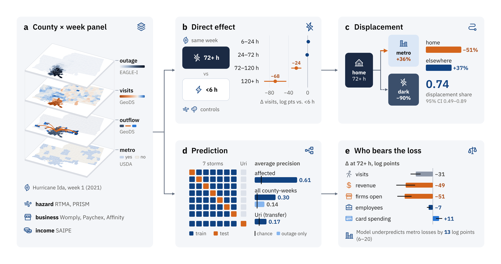
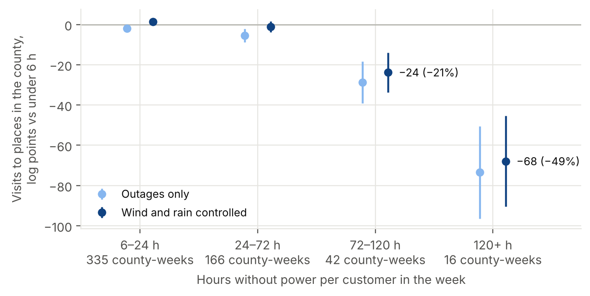
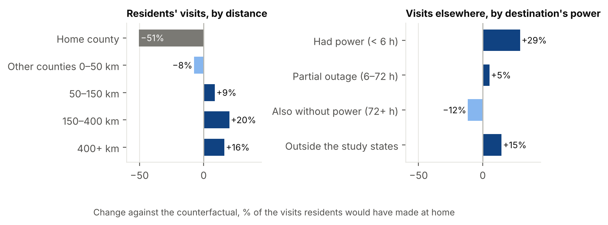
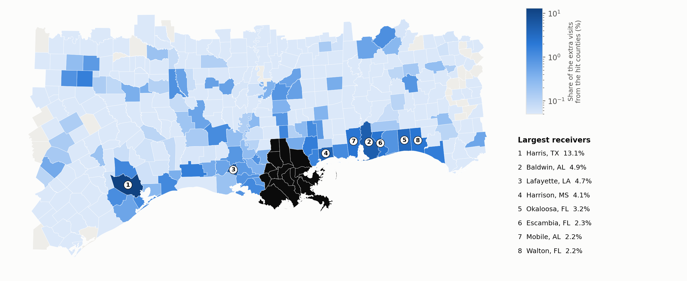
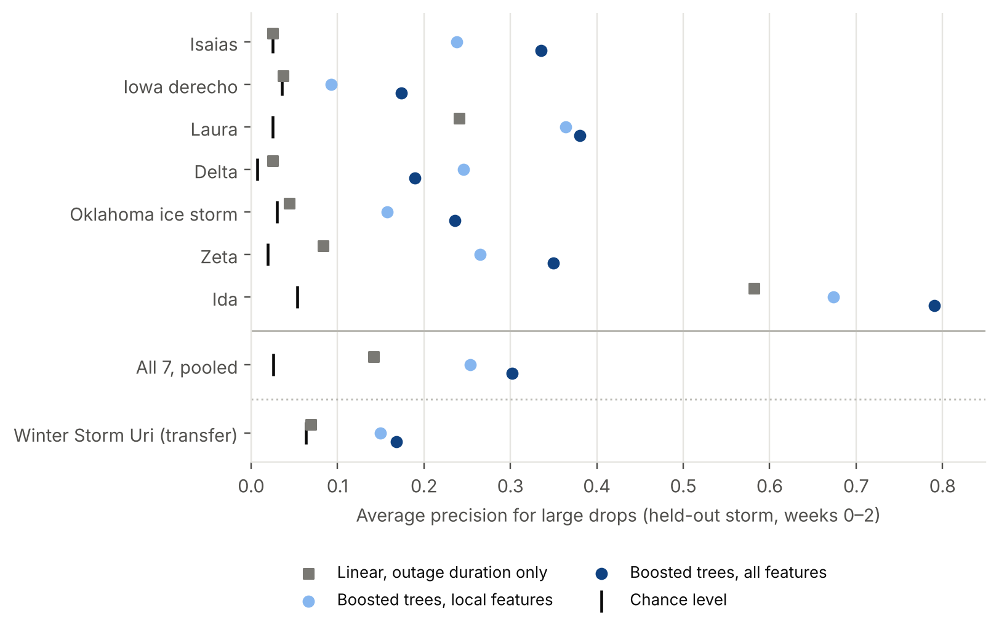
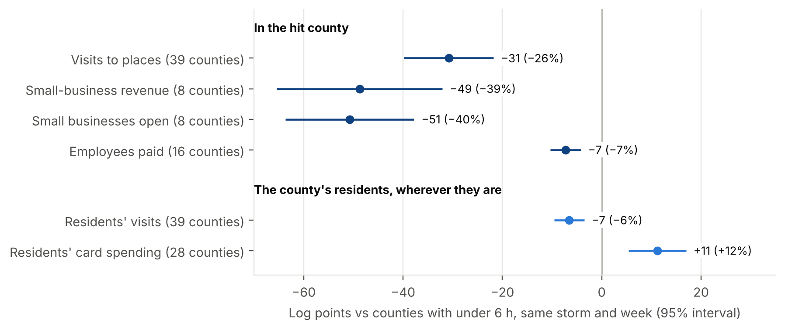

# When the Lights Stay Off: Power Outages and the Displacement of Local Activity

When a U.S. county loses power for three days or more after a storm, visits to its shops and services are about a quarter lower than in comparable counties, beyond what the storm's wind and rain explain. An estimated three quarters (95% interval: half to nine tenths) of the activity its residents lose at home reappears in other counties, mostly where the power is still on and in counties they already visited before the storm. A model trained on six storms flags these collapses in an unseen seventh, but not in a winter grid failure. Small-business revenue falls by about two fifths in the eight hit counties with small-business data, while residents' card spending rises in the 28 with spending data.

This repository holds the notebooks, result tables and figures behind these findings.

*Data and analysis pipeline. (a) The county × week panel, shown for Hurricane Ida in the week after landfall: hours without power (EAGLE-I), change in visits and flows between counties (GeoDS), and metro status (USDA); hazard, business and income data are joined to each county-week. (b) Change in visits by weekly outage band, against counties with under 6 hours in the same storm and week (Result 1). (c) Residents' visits lost at home and gained elsewhere, and the destinations that received them (Results 2 and 3). (d) Leave-one-storm-out prediction and average precision for large drops; ticks mark chance (Result 4). (e) Change at 72+ hours in visits, small-business revenue, businesses open, employees paid and residents' card spending, and the model's underestimate in metro counties (Result 5). A PDF version is in [figures/fig0_overview.pdf](figures/fig0_overview.pdf).*

## Question

How does an infrastructure failure propagate into human activity? Does a long outage suppress local activity, and does that activity stop or move through the mobility network? Who bears the loss?

The study covers seven storms in 2020–21: hurricanes Isaias, Laura, Delta, Zeta and Ida, the August 2020 Iowa derecho and the October 2020 Oklahoma ice storm. Winter Storm Uri (February 2021) is held out and used only to test transfer to a different kind of grid failure. The main sample has 38,808 county-weeks in 3,234 county-events; 58 county-weeks in 39 counties had 72 or more hours without power per customer.

## Data

| Data | Source | Unit | Used for |
| --- | --- | --- | --- |
| Customers without power | DOE EAGLE-I (ORNL), every 15 minutes | County | Hours without power per customer per week |
| Visits to places | GeoDS weekly county-to-county flows (derived from SafeGraph) | County pair, week | Local activity, outflow, network exposure |
| Wind, rain, frozen precipitation, temperature | NOAA RTMA and PRISM, in Google Earth Engine | County, week | Hazard controls |
| Small-business revenue and businesses open | Womply, via the Opportunity Insights Economic Tracker | County where the business is | Step 5 |
| Employees paid, by wage | Paychex, via the Opportunity Insights Economic Tracker | County | Step 5 |
| Card spending | Affinity Solutions, via the Opportunity Insights Economic Tracker | County where the cardholder lives | Step 5 |
| Median household income | Census SAIPE 2019 | County | Step 5 |
| Rural–urban status | USDA Rural-Urban Continuum Codes 2013 | County | Step 5 |
| County boundaries, coastline | Census cartographic boundaries and TIGER 2020 | County | Distances, coastal check |

Sources, coverage and terms are listed in [DATA_SOURCES.md](DATA_SOURCES.md).

## Approach

- **Outcome**: visits to places in a county, scaled by national weekly visits and expressed in log points (100 × log difference) from the county's own pre-storm baseline (weeks −5 to −2, excluding weeks with outages).
- **Design**: event × week fixed effects compare each county with counties in the same storm's study area in the same week. Outage effects are estimated in bands of weekly hours without power per customer (reference: under 6 hours), with banded controls for current and cumulative wind and rain. Standard errors are clustered by county; with few treated counties, inference also uses a wild cluster bootstrap (Webb weights, null imposed).
- **Decision rules**: most notebooks state, before their main estimates, the rule that turns the estimates into a conclusion, and end with a checklist. Step 4b was added after the Step 4 results, and the Step 5 rules for small-business revenue and card spending were set after Step 2b had shown those data in a cruder form; Step 5 says so in its rules.
- **Outflow**: residents' visits are split into home county and other counties and compared with same-week counties without outages, giving a displacement share (extra visits elsewhere ÷ visits lost at home). Destinations are compared with a Poisson pseudo-maximum-likelihood model relative to each county's usual split.
- **Prediction**: gradient-boosted trees with fixed hyperparameters, evaluated leave one storm out and on Winter Storm Uri, by average precision for large drops (20+ log points below counties without outages in the same week).

## Results

### 1. Long outages go with lower local activity beyond what the storm explains

In weeks with 3–5 days without power per customer, visits to places in the county were 24 log points (about 21%) lower than in counties with under 6 hours; beyond 5 days they were 68 log points (about 49%) lower. Wind and rain controls absorb almost all of the drop for shorter outages, but only 8–17% of it for long ones.

With 72+ hours as one band (58 county-weeks in 39 counties) and wind and rain effects allowed to fade week by week, the estimate is −30.8 log points (about 26%; 95% interval −39.8 to −21.8). It stays between −14.7 and −33.8 in every robustness check with these controls (−14.6 to −39.6 with the controls of the figure above), with wild cluster bootstrap p < 0.001 throughout: comparing only counties in the same cumulative-gust band −21.0; county × event fixed effects −29.7; without Ida −20.1; without Laura −33.8; without counties within 25, 50 and 100 km of the coast −24.7, −18.2 and −14.7. The effect shrinks away from the coast, so storm surge may account for part of the coastal estimates. In the Iowa derecho, the one event without storm surge, the estimate is smaller and not significant (−10.7, 95% interval −23.9 to +2.5, 7 county-weeks), so the evidence comes mainly from Gulf Coast hurricanes.

### 2. Much of the lost activity moved rather than stopped

In the 58 county-weeks with 72+ hours of outage, residents' visits in their home county fell 51% against the counterfactual, while their visits in other counties rose by 37% of that home counterfactual: a displacement share of 0.74 (95% interval 0.49–0.89, resampling counties), between "part" and "most" of it moving under the rule set in advance. The share was 0.67 at 3–5 days and 0.80 beyond 5 days, a difference within the margin of error. Laura (1.01) and Ida (0.67) displaced most of the lost activity; the Iowa derecho, a sudden storm without evacuation orders, displaced little (0.19, 7 county-weeks; upper bound 0.33); Zeta and Delta have too few hit county-weeks to say. 36% of home visits reappeared 150+ km away, while counties within 50 km lost visits from hit residents (−8% of the home counterfactual).

### 3. Displaced activity followed existing ties toward power and large metros

Relative to each hit county's usual split of out-of-county visits, destinations also without power received 90% fewer visits than destinations with power (95% interval 87–93%), and counties of 500,000+ people 36% more than counties under 100,000 (20–56%). Once power is accounted for, distance has no clear effect. Only 2.9% of out-of-county visits in outage weeks went to counties residents had not visited before the storm.

In week 1 of Ida (the week after landfall), Harris County (Houston, 418 km away) received 13% of the extra out-of-county visits, followed by Baldwin, AL (4.9%), Lafayette, LA (4.7%) and Harrison, MS (4.1%). The inflow shows up in the receiving counties' visitors, not in their total visits: where 2% or more of a county's usual visitors came from hit counties, total visits did not rise significantly (+2.0 log points, 95% interval −1.2 to +5.3; the test set in advance), while visitors from other counties rose 12 log points (6.8–17.3; bootstrap p = 0.002). Adding this network exposure changes the 72+ hour estimate by 4% (−30.8 to −32.1), below the 20% set in advance as the threshold for a correction.

### 4. A model trained on six storms flags collapses in the seventh, but not in a winter grid failure

Among county-weeks with an outage at home or in the mobility network, average precision for large drops is 0.61 against a chance level of 0.09; over all county-weeks it is 0.30 against 0.03, double the 0.14 of a linear model that uses outage duration alone.

- **No transfer to Uri**: average precision 0.17 against a chance level of 0.06, and R² below zero. During the freeze, counties without power did not lose significantly more visits than others (72+ h: −5.2, 95% interval −11.9 to +1.6), plausibly because the whole state stayed home.
- **The network adds position, not propagation**: outage exposure through the mobility network shows no detectable improvement in prediction (difference −0.02, 95% interval −0.06 to +0.03, among affected county-weeks). The usual share of visitors from outside the county helps, but it also predicts swings unrelated to outages.
- **The largest misses are Ida's New Orleans metro**: Orleans fell at least 150 log points below counties without outages (the outcome is capped at 150) against a predicted 24, Jefferson 145 against 26. Across the seven storms, losses in counties of 50,000+ people were underestimated by 13.5 log points on average, against 1.0 for smaller counties; one possible reason is that no training storm displaced a metro area of Ida's size.

### 5. The loss lands on local businesses, and the model misses metro counties

In county-weeks with 72+ hours of outage, small-business revenue was 49 log points (39%) lower than in counties with under 6 hours, and the number of small businesses open 51 log points (40%) lower; employees paid fell 7 log points. Residents' card spending, counted where cardholders live, rose 11 log points (12%; 28 counties), consistent with spending that followed residents out of the county and with evacuation and repair costs. The business estimates rest on eight counties, mostly Ida parishes.

- **In the Womply counties, visits fell more than revenue**: in the same county-weeks, revenue fell 18 log points less than visits (95% interval 7–29), so foot traffic may overstate revenue losses in long outages; this rests on eight counties.
- **No clear income gradient**: employees paid below the median wage fell 10 log points and above it 6 (difference −5, interval −11 to +1). The displacement share was 0.76 in the lower-income half of hit counties and 0.81 in the higher-income half (difference +0.05, interval −0.50 to +0.30, adjusted for the mix of storms). The metro–nonmetro comparison of displacement is uninformative (+0.29, interval −2.73 to +3.37, from the derecho and Laura only), because 22 of Ida's 23 hit county-weeks are in metro parishes.
- **The model misses metro and higher-income counties**: within the same storm, the losses of metro counties were underestimated by 13 log points more than those of nonmetro counties (interval 6–20), and the losses of the higher-income half by 12 more than the lower-income half (3–21). Income and metro status overlap (among the 39 hardest-hit counties, metro counties' median household income was $55,000 against $47,000), so the two cannot be told apart.

## Limitations

- **Concentration**: seven Louisiana parishes in Laura and Ida account for about 80% of the lost home visits, so the results speak mainly to Gulf Coast hurricanes.
- **Measurement**: SafeGraph infers a device's home over several weeks, so long displacement may be reassigned to the destination; only visits to points of interest are seen; small county-pair flows are suppressed, so new destinations may be undercounted; for Delta, 15% of counties with 24+ hours of outage have no visit change in weeks 0–1.
- **Hazard controls**: hourly RTMA gusts miss short convective gusts (the derecho), and storm surge is not controlled; the coastal gradient is consistent with surge. In the derecho, county gusts and outage durations were almost uncorrelated (Spearman 0.05).
- **Business data**: Womply covers 8 of the 39 hit counties; Paychex weeks end on Friday and pay cycles may delay changes in employment; Affinity includes online spending and does not show where it happens.
- **Period**: 2020–21, during the pandemic; a destination's power is observed only within the study states.

## Repository layout

| Path | Content |
| --- | --- |
| `notebooks/step1_data_panel.ipynb` | First pass: daily BTS trips for six events in 2020–23; trips did not register outages, which led to Step 1b |
| `notebooks/step1b_data_panel.ipynb` | Events, EAGLE-I outages, GeoDS visits, Womply and Affinity; the weekly panel |
| `notebooks/step2a_hazard_weekly.ipynb` | Weekly wind, rain and cold per county from RTMA and PRISM (Google Earth Engine) |
| `notebooks/step2b_direct_effects.ipynb` | Outage bands and local visits; event study; other outcomes |
| `notebooks/step2c_robustness.ipynb` | Week-varying hazard controls, county × event fixed effects, wild cluster bootstrap, inland counties |
| `notebooks/step3_outflow.ipynb` | Displacement share, destinations (PPML), network exposure and spillovers, Ida map |
| `notebooks/step4_prediction.ipynb` | Gradient-boosted prediction, leave one storm out, transfer to Uri |
| `notebooks/step4b_ablation.ipynb` | Which network features help: dynamic exposure vs static position |
| `notebooks/step5_who_bears.ipynb` | Businesses, workers and residents; income and rural–urban differences |
| `results/<step>/` | Tables (CSV) and figures (PNG) written by each notebook, from the runs reported above |
| `figures/` | The overview figure (`fig0_overview`, PNG and PDF) and the five result figures above |
| `scripts/make_summary_figures.py` | Makes the five result figures (`fig1`–`fig5`) from `results/` |

The weekly panel and the raw downloads are not included; Step 1b rebuilds them from the public sources. The overview figure was drawn separately; its numbers come from `results/`, and its icons are from [Phosphor Icons](https://phosphoricons.com) (MIT License).

## Reproducing

The notebooks run in Google Colab and read and write the Google Drive folder `MyDrive/outage_mobility` (outside Colab, `./outage_mobility`). Run them in order: Step 1b, 2a, 2b, 2c, 3, 4, 4b, 5. Step 1 is the first pass and is not needed by later steps.

- Step 1b downloads about 6 GB (EAGLE-I for 2020 and 2021, 56 GeoDS weeks) and keeps the extracted and filtered files in Drive, so an interrupted run resumes.
- Step 2a needs a Google Earth Engine account: set `PROJECT_ID` in its parameters cell ("2. Parameters") to an Earth Engine Cloud project ID.
- Step 2c downloads the Census county boundaries and coastline (about 15 MB); Steps 3, 4 and 4b reuse them.
- Steps 2b to 5 run in minutes. Step 5 downloads the Paychex series, SAIPE 2019 and the 2013 Rural-Urban Continuum Codes.
- Packages: pandas, numpy, scipy, statsmodels, scikit-learn, geopandas, matplotlib, requests, earthengine-api (Step 2a) and xlrd (Step 5).

`python scripts/make_summary_figures.py`, run from the repository root, redraws `fig1`–`fig5` in `figures/` from `results/`.

## Related project

The companion repository `us-hurricane-outage-duration` models how long the power stays out across nine U.S. hurricanes, using the same EAGLE-I records; Steps 1 and 1b cross-check their outage labels against it when its Drive folder (`us_flood_outage`) is present.
